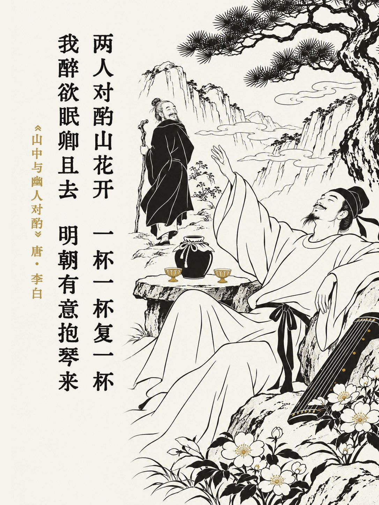

# poem-card

**AI 只画画，代码只排字：把一首古诗做成一张留白讲究、文字零错字、可以直接发的 3:4 诗意插画。**

poem-card 是一个给 Claude Code 等 AI agent 用的诗画技能（skill 名 `poem-plate`）：本机 Codex CLI 画出左侧留白、不带任何文字的古典插画，Python 脚本再按固定版式用京華老宋体竖排诗句和金色出处。成系列做时，每张的字号、粗细、边距完全一致。

An agent skill for classical Chinese poem cards: the local Codex CLI draws a text-free illustration with an empty left margin, and `typeset.py` sets the poem vertically in KingHwa OldSong with a fixed house layout.

> 本仓库 fork 自 [ythx-101/poem-plate](https://github.com/ythx-101/poem-plate)，把默认流程从“生图 + 重新配色合成”改成了“codex 出无字图 + 固定版式排字”。原作者的合成方式保留为备用。

## 示例

<table>
<tr>
<td></td>
<td></td>
<td></td>
</tr>
<tr>
<td align="center"><sub>白居易《问刘十九》</sub></td>
<td align="center"><sub>李白《山中与幽人对酌》</sub></td>
<td align="center"><sub>李白《独坐敬亭山》</sub></td>
</tr>
</table>

三张用的是同一套版式：五言、七言自动排两列，字号、粗细、边距一致。

排字前后对比，左边是 Codex 出的无字原图，右边是 `typeset.py` 排字后的成品（画面没有改动）：

<table>
<tr>
<td></td>
<td></td>
</tr>
<tr>
<td align="center"><sub>codex_gen.py 出的无字原图</sub></td>
<td align="center"><sub>typeset.py 排字后</sub></td>
</tr>
</table>

## 流程

1. **核对原文**：诗句、诗题、作者、朝代逐字对照可靠全文（搜韵、维基文库）。有通行异文先确认用哪版。
2. **选句**：版式是两列大字、每列两句。绝句四句全上；律诗挑最有画面感的两联。
3. **出图**：`codex_gen.py` 调用 Codex CLI 内置生图，一首并行出两张候选。提示词要求左边 35% 完全留空、画里不放任何字、只用纸色、墨色和一种金色。
4. **挑图**：看左边是否真的空着、手画得对不对、服饰道具合不合朝代。
5. **排字**：`typeset.py` 按固定版式排字，画面原样保留、不重新配色。
6. **检查定稿**：逐字核对成品，存为带“定稿”字样的文件。

## 为什么这样分工

| 做法 | 问题 |
|---|---|
| 让 AI 直接把诗写进画里 | 竖排中文常有错字、漏字，字体也只能靠描述 |
| 生图后由代码重新配纸、墨、金三色（原版做法） | GPT 生图的米色皮肤和衣料会被误判成金色，出现大片斑驳金黄 |
| **AI 只画无字图，代码只排字** | 字一定准确，画面保持原样，系列版式统一 |

## 固定版式

按 Codex 出图尺寸 1086×1448 实测，其他尺寸按宽度等比缩放：

- 字体：京華老宋体，笔画描边加粗 0.016
- 大字：62 号，字距 69.6px，两句之间多空 64px，上边距 96px
- 三列：右列第 1、2 句，左列第 3、4 句，两列中心距 100px，左边距约 89px
- 出处：金色 `#B68F44`，写成「《诗题》朝代·作者」，竖向中心对齐左列
- 不加系列小字、不加署名
- 画面距文字不足 30px 时自动整体右移（右边裁掉的是本来就出血到画布外的部分），右移超过 80px 会警告

## 安装

```bash
git clone https://github.com/zbqpassion/poem-card ~/.claude/skills/poem-plate
cd ~/.claude/skills/poem-plate
pip install -r requirements.txt
```

还需要：

- **字体**：自行下载京華老宋体，改名为 `KingHwaOldSong.ttf` 放进 `fonts/`（字体不随仓库分发，见 [fonts/README.md](fonts/README.md)）。换字体用环境变量 `POEM_FONT`。
- **出图**：安装 [Codex CLI](https://github.com/openai/codex) 并用 ChatGPT 账号登录，内置生图走账号额度，不需要 API key。也可以用任何能出 3:4 插画的模型自己出图，只要左边留空、画里无字。

## 快速开始

```bash
# 1. 出图：提示词骨架见 SKILL.md 第 2 步，写进 prompt.txt
python codex_gen.py --prompt-file work/问刘十九/prompt.txt --out work/问刘十九/raw-a.png
python codex_gen.py --prompt-file work/问刘十九/prompt.txt --out work/问刘十九/raw-b.png

# 2. 挑一张排字
python typeset.py work/问刘十九/raw-b.png work/问刘十九/问刘十九_定稿.png \
    --lines 绿蚁新醅酒 红泥小火炉 晚来天欲雪 能饮一杯无 \
    --title 问刘十九 --dynasty 唐 --author 白居易
```

`--lines` 必须给四句，不带标点；`--source` 可以整串替换出处文字。每次运行会打印字号、各列上下范围和画面右移量。

Codex 每张图是一个独立会话，约 1 到 2 分钟，建议后台并行跑。生成的原件同时保留在 `~/.codex/generated_images/<会话id>/`。

## 文件

| 文件 | 用途 |
|---|---|
| `SKILL.md` | 给 agent 读的完整流程、提示词骨架和检查标准 |
| `codex_gen.py` | 调用 Codex CLI 出图，按会话 id 取回原图 |
| `typeset.py` | 固定版式排字 |
| `compose_lib.py`、`example_compose.py`、`compose/` | 原作者的合成方式（备用） |
| `styles/classical-styles.md` | 11 种中国古典人物画法与提示词骨架 |
| `examples/` | 示例图：`card-*.jpg` 是新流程成品，其余是原作者的示例 |

## 备用：原版合成与动漫判词

原作者的做法是把画缩小推到右侧，重新映射成纸、墨、金三色，再排字加署名（`example_compose.py`，画布 1500×2000）。只适合本来就是纯三色的生图结果，所以默认不用。


原作者的 v2 还支持把动漫角色画成古典诗画：红楼式判词（七言绝句、平水韵、每句藏剧情典故）配 11 种古典画法，见 [styles/classical-styles.md](styles/classical-styles.md) 和 `compose/` 里的《无职转生》示例。


## English

**poem-card** is a fork of [ythx-101/poem-plate](https://github.com/ythx-101/poem-plate). The default pipeline is: verify the poem text, have the Codex CLI (`codex_gen.py`) draw two text-free candidates that keep the left 35% of the canvas empty, pick one, then run `typeset.py` to set four lines in two vertical columns of KingHwa OldSong with a gold source column (《title》dynasty·author) centred on the left column. The drawing is never recoloured; if it comes within 30px of the text it is shifted right. The original recolour-and-compose pipeline (`compose_lib.py`) is kept as a fallback. Fonts are not redistributed; see `fonts/README.md`.

## License

MIT（沿用原项目）
